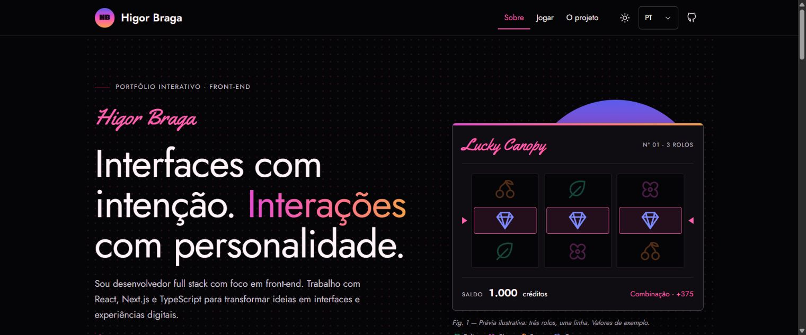
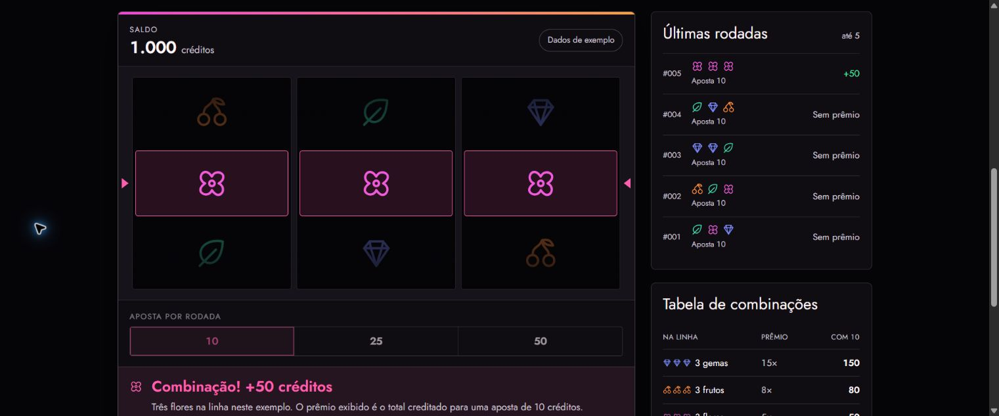

# Lucky Canopy

Portfólio de Higor Braga com uma demonstração de jogo de três rolos, construída para apresentar interface, integração com API, persistência e entrega contínua.

**Os créditos são fictícios. Não há depósitos, saques, pagamentos ou prêmios com valor monetário.** Projeto independente de portfólio, criado para demonstrar desenvolvimento web.

[Acessar o projeto](https://jungle-gaming-inky.vercel.app/) · [Abrir a demonstração](https://jungle-gaming-inky.vercel.app/play) · [Conhecer a arquitetura](https://jungle-gaming-inky.vercel.app/project)

## Prévia

Apresentação do portfólio no tema escuro:



Interface do jogo com rolos, histórico e tabela de combinações. Esta captura usa um cenário fixo da galeria de estados, com dados ilustrativos:



## O que explorar

| Página      | Conteúdo                                             |
| ----------- | ---------------------------------------------------- |
| `/`         | Apresentação, conhecimentos e projetos selecionados  |
| `/play`     | Máquina, regras e exemplos, com sessão persistida    |
| `/project`  | Fluxo da rodada e decisões de arquitetura            |
| `/system`   | Tokens e componentes da interface                    |
| `/showcase` | Galeria de estados visuais, sem modificar uma sessão |

A interface tem versões PT-BR/EN, temas claro/escuro, adaptação para telas menores e respeito à preferência de movimento reduzido.

## Stack e responsabilidades

| Tecnologia                        | Uso neste projeto                                            |
| --------------------------------- | ------------------------------------------------------------ |
| Next.js 16, React 19 e TypeScript | Páginas, composição da interface e rotas HTTP no servidor    |
| TanStack Router                   | Painéis internos de `/play`, com histórico em memória        |
| TanStack Query e Axios            | Estado remoto e comunicação com a API                        |
| Socket.IO                         | Avisos de atualização e sincronização após reconexão         |
| PostgreSQL / Neon e `pg`          | Sessões, transações, rodadas e notificações entre instâncias |
| Zod                               | Validação de entradas e respostas na execução                |
| Tailwind CSS e shadcn/ui          | Estilos, tokens e componentes locais baseados em Radix       |
| i18next                           | Traduções e idioma da interface                              |
| Vitest, Husky e GitHub Actions    | Testes, validação antes do commit e CI/CD                    |
| Vercel Services                   | Web e realtime sob o mesmo domínio                           |

Versões exatas em [package.json](package.json), [package-lock.json](package-lock.json) e [.nvmrc](.nvmrc).

## Executar localmente

Pré-requisitos: Git, Node.js **22.19.0** e npm **11.6.0**. Para jogar, configure um PostgreSQL de desenvolvimento; as páginas públicas e a galeria podem ser exploradas sem banco.

```sh
git clone https://github.com/BragaHigor/jungle-gaming.git
cd jungle-gaming
npm ci
```

No PowerShell, copie o modelo de ambiente:

```powershell
Copy-Item .env.example .env.local
```

Em Linux/macOS, use `cp .env.example .env.local`. Preencha `DATABASE_URL` em `.env.local` e aplique [database/001-game.sql](database/001-game.sql) no mesmo banco. O [guia de desenvolvimento](docs/desenvolvimento.md) detalha essas etapas e as variáveis.

Inicie dois terminais na raiz do projeto:

```sh
# Terminal 1: aplicação web
npm run dev
```

```sh
# Terminal 2: atualizações ao vivo
npm run dev:realtime
```

Abra **http://localhost:3000**. Em `/play`, clique em **Iniciar demonstração** para criar a sessão com 1.000 créditos fictícios. O primeiro GET sem cookie retorna `401 SESSION_REQUIRED`: é o estado esperado antes de iniciar.

Use `localhost` nos dois serviços. O cookie da sessão precisa chegar à API e ao realtime. Não alterne com `127.0.0.1`.

## Como uma rodada funciona

1. O cliente salva um identificador da intenção e envia a aposta por HTTP.
2. O servidor valida a entrada e bloqueia a sessão dentro de uma transação PostgreSQL.
3. Uma função de sorteio no servidor fornece os símbolos; regras calculam o prêmio e persistem o saldo uma única vez por identificador.
4. A resposta confirma o resultado. Saldo, histórico e prêmio apresentados aguardam o fim da animação dos rolos.
5. Eventos avisam outras conexões da mesma sessão para consultar a API. Eles não somam saldo no navegador.

Uma resposta perdida não dispara outra aposta automaticamente. O cliente tenta recuperar a operação por GET e mantém uma pendência quando não consegue confirmar o resultado.

## Qualidade

```sh
npm run check
```

Executa lint, formatação, tipos, testes e build. O Husky usa o mesmo comando no pre-commit. Testes PostgreSQL são separados e exigem um banco de testes explícito:

```sh
npm run test:integration
```

Configure `TEST_DATABASE_URL` no processo antes desse comando. Consulte [como executar a integração](docs/desenvolvimento.md#testes). A CI fornece um PostgreSQL descartável; não usa o Neon de produção para testar.

## Entrega

Branches de trabalho partem de `develop` e voltam por PR. O push integrado em `develop` publica HML/Preview; em `main`, PRD/Production. O deploy depende da validação do mesmo SHA. Produção só recebe os domínios depois das verificações HTTP de serviços e páginas.

URLs de Preview mudam a cada deployment e podem exigir login na Vercel. O resumo do job **Deploy Vercel** contém o link correspondente ao commit. Detalhes em [ambientes e CI/CD](docs/entrega.md).

## Documentação

- [Configuração, comandos e diagnóstico](docs/desenvolvimento.md)
- [Arquitetura, API e consistência](docs/arquitetura.md)
- [Ambientes, CI/CD e operação](docs/entrega.md)
- [Manutenção e limites](docs/manutencao.md)

## Autoria

[Higor Braga](https://github.com/BragaHigor). Projeto autoral, com uso de ferramentas de IA durante o desenvolvimento. As decisões, os testes e os limites da implementação estão documentados neste repositório.
