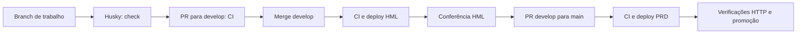

# Ambientes e entrega

[Voltar ao README](../README.md)

## Ambientes

| Ambiente        | Código                                   | Hospedagem             | Banco                                       |
| --------------- | ---------------------------------------- | ---------------------- | ------------------------------------------- |
| Desenvolvimento | Branch de trabalho a partir de `develop` | Next + realtime locais | Neon de desenvolvimento ou PostgreSQL local |
| HML             | `develop`                                | Vercel Preview         | Neon homologation                           |
| PRD             | `main`                                   | Vercel Production      | Neon production                             |

Produção: https://jungle-gaming-inky.vercel.app/. URLs HML devem ser obtidas no resumo da execução **Deploy Vercel** correspondente ao SHA; não usar um link antigo como prova do código atual. Preview pode exigir login na Vercel.

## Validação e publicação

O workflow [.github/workflows/ci.yml](../.github/workflows/ci.yml) tem dois jobs:

1. **Validacao:** `npm ci`, `npm run check` e integração em um PostgreSQL 17 descartável no runner Ubuntu. Não acessa Neon PRD. O Husky é desativado no runner porque o workflow executa os checks diretamente.
2. **Deploy Vercel:** depende do primeiro e só executa em push para `develop` ou `main`. Faz checkout de `github.sha`, instala CLI fixada e envia o código para build na Vercel com o ambiente de destino. O artefato binário do build anterior não é reutilizado.

PRs e `workflow_dispatch` validam sem publicar. CI falhando impede o job de deploy. Em produção, `--skip-domain` cria o candidato sem mover os aliases principais; depois dos healths e das cinco páginas públicas, `vercel promote` atualiza os domínios. Se uma verificação falhar, a promoção não executa; o candidato já pode existir na Vercel. [Referência CLI](https://vercel.com/docs/cli/deploy).

O processo exige conferir HML antes do PR para main; essa conferência funcional não é automatizada pelo workflow. Healths/páginas não testam uma rodada nem garantem WSS autenticado. O Husky também não substitui a CI: hooks locais podem ser ignorados.

## Configuração das contas

Nos ambientes GitHub `hml` e `prd`:

| Tipo     | Nome                |
| -------- | ------------------- |
| Secret   | `VERCEL_TOKEN`      |
| Variable | `VERCEL_ORG_ID`     |
| Variable | `VERCEL_PROJECT_ID` |

As políticas dos ambientes permitem `develop` em HML e `main` em PRD. As proteções de branches exigem PR e check `Validacao` atualizado, sem revisor adicional obrigatório no fluxo individual. Essas configurações residem nas contas, não são criadas pelo YAML.

O token de CI tem prazo de validade: renovar antes do vencimento e atualizar os dois secrets. Revisar também o acesso de automação usado por `vercel curl` para consultar deployments protegidos. Não desligar proteção de Preview para fazer o check passar. Nenhuma credencial deve entrar neste repositório.

## Vercel Services

[vercel.json](../vercel.json) declara `web` e `realtime` sob a mesma origem. `/api/realtime/*` entra no servidor Node; `/` tem regra explícita para o web; a regra geral encaminha o restante ao Next. Node 22, Fluid e região de funções São Paulo foram adotados. A região da máquina de build pode ser diferente da região das funções.

O serviço web executa `npm run build`. O realtime declara `node --version` para não herdar esse comando: uma segunda execução do Next na mesma raiz apaga os artefatos preparados pelo adaptador web. O builder Node cuida do TypeScript do realtime. A rota inicial explícita evita depender apenas do tratamento de um caminho vazio na regra geral. São decisões motivadas pelos problemas encontrados na implantação.

`git.deploymentEnabled: false` evita um segundo deploy pela integração Git. `.vercelignore` exclui ambientes locais, dependências e resultados de build/testes do upload. Services e WebSockets são recursos Beta: acompanhar alterações e limites da plataforma. [Services](https://vercel.com/docs/services), [WebSockets](https://vercel.com/docs/functions/websockets).

Na Vercel, `DATABASE_URL` é diferente em Preview e Production. Configure `NEXT_PUBLIC_REALTIME_URL=/` e o caminho compartilhado. Origens dos hosts de deployment/branch são derivadas no servidor; domínios adicionais exigem origens HTTPS exatas. Segredos de banco nunca usam prefixo público. Mudanças de ambiente exigem novo deployment.

## Conferência depois de publicar

1. Conferir SHA, URL e resultado dos jobs; abrir `/`, `/play`, `/project`, `/system` e `/showcase`.
2. Iniciar uma sessão fictícia no ambiente escolhido e confirmar recuperação após reload. O GET inicial 401 sem cookie é esperado.
3. Conferir conexão ao vivo e reconexão; no navegador, o upgrade WebSocket deve concluir com 101.
4. Testar manualmente a rodada, revelação conjunta de saldo/histórico e recuperação de falha usando sessão descartável. Isso modifica dados: executar conscientemente no ambiente de teste.
5. Confirmar que HML/PRD usam seus próprios bancos; uma sessão de um hostname não deve ser tomada como prova da sessão de outro.

Higor confirmou o funcionamento de DEV, HML e PRD ao encerrar a implantação. Isso é aceite funcional informado pelo mantenedor, não um teste de carga, garantia permanente ou monitoramento automático.

## Recuperação de uma entrega

Se uma publicação falhar, identificar o primeiro passo com erro e o SHA antes de repetir. Corrigir em branch baseada em develop e passar pelo PR. Em um problema após promoção, avaliar rollback para um deployment previamente validado pelo painel da Vercel; não promover um Preview com variáveis HML como se fosse PRD. Um rollback de aplicação não reverte schema/dados. Migrations precisam de compatibilidade e plano próprio.
